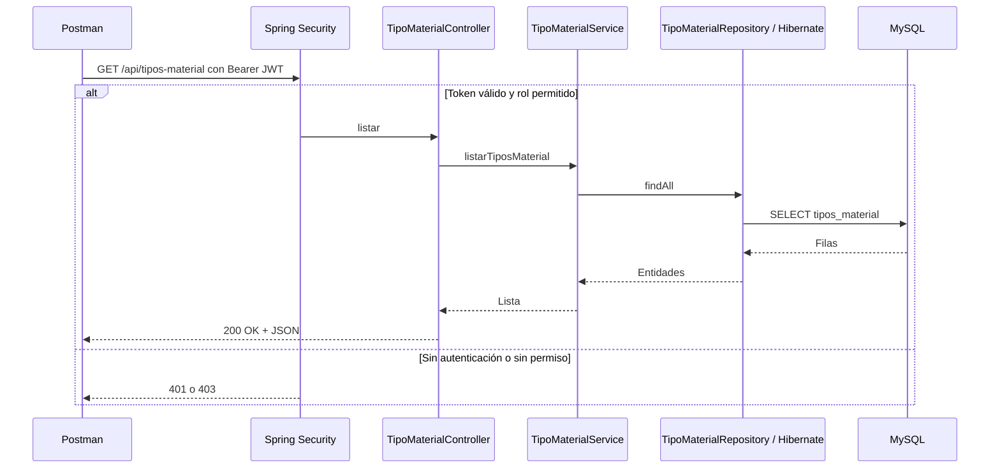
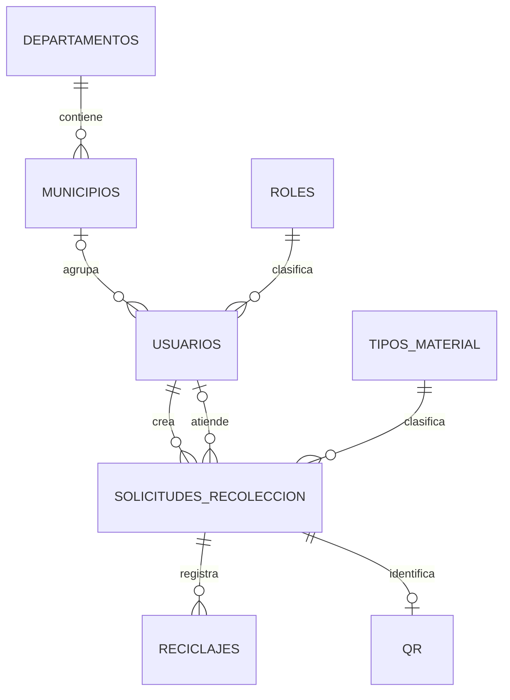

# Sustentación de AmbiGPS

## Petición HTTP



## Seguridad y archivos

- Spring Security autentica, aplica los permisos y verifica contraseñas con BCrypt.
- JJWT 0.12.3 firma tokens y verifica la firma y el vencimiento. El correo es el sujeto del token.
- AuthController recibe LoginRequest y devuelve AuthResponse. JwtService crea y valida tokens. JwtAuthenticationFilter toma el Bearer del encabezado y carga el rol actual mediante CustomUserDetailsService.
- SecurityConfig centraliza los permisos por ruta y verbo HTTP, configura sesiones sin estado y distingue 401 (sin autenticación) de 403 (sin permiso).
- Usuario acepta el campo passwordHash al crear cuentas, pero el servicio lo cifra con BCrypt y el campo queda excluido del JSON de salida. EscrituraAuditada obtiene el actor del contexto de seguridad al guardar usuarios y reciclajes.

### Matriz de acceso

| Ruta | Operación | Acceso |
|---|---|---|
| /api/auth/login | POST | Público |
| /api/usuarios, /api/roles | Todas | ADMIN |
| /api/solicitudes | GET | ADMIN, USUARIO, RECICLADOR |
| /api/solicitudes | POST | ADMIN, USUARIO |
| /api/solicitudes | PUT, PATCH | ADMIN, RECICLADOR |
| /api/solicitudes | DELETE | ADMIN |
| /api/reciclajes | Todas | ADMIN, RECICLADOR |
| /api/tipos-material, /api/departamentos, /api/municipios | GET | ADMIN, USUARIO, RECICLADOR |
| Los mismos catálogos | Escritura | ADMIN |
| /api/qr | GET | ADMIN, USUARIO, RECICLADOR |
| /api/qr | Escritura | ADMIN, RECICLADOR |
| /api/historial, /api/notificaciones | GET | ADMIN, USUARIO, RECICLADOR |
| /api/notificaciones/{id}/marcar-leida | PATCH | ADMIN, USUARIO, RECICLADOR |
| /api/historial, /api/notificaciones | Demás escrituras | ADMIN |

Las reglas incluyen los subpaths de cada grupo. Los permisos son por rol. El modelo actual de solicitudes no filtra automáticamente por el propietario ni por el reciclador autenticado.

## Modelo de datos



El núcleo tiene relaciones 1:N y una 1:1 opcional. No hay una relación N:M directa en las entidades. El reciclador es un usuario con rol RECICLADOR.

## Auditoría en MySQL

En una instalación nueva, crea el esquema y arranca el backend una vez para que Hibernate genere las tablas. Ejecuta [auditoria.sql](../auditoria.sql) en Workbench con las escrituras detenidas. El script conserva las filas existentes de auditoria_sistema y reemplaza los triggers anteriores de usuarios y reciclajes.

Cada tabla tiene un trigger AFTER para INSERT, UPDATE y DELETE. El INSERT registra NEW, el UPDATE registra OLD y NEW, y el DELETE registra OLD. Los cambios y su auditoría quedan en la misma transacción. Las llamadas de la API registran el correo autenticado. Los cambios directos en Workbench usan la cuenta de la conexión MySQL. Las contraseñas y hashes se excluyen del JSON de auditoría.

Para mostrar los resultados después de una operación de prueba:

```sql
SELECT usuario_actor, accion, fecha_hora, tabla_afectada, id_registro,
       datos_anteriores, datos_nuevos
FROM ambigps.auditoria_sistema
ORDER BY id_auditoria DESC
LIMIT 10;
```

## Demostración en Postman

Importa [AmbiGPS.postman_collection.json](AmbiGPS.postman_collection.json). Configura localmente la variable password con la contraseña de la cuenta USUARIO y ejecuta las cuatro peticiones en orden. La primera guarda el JWT en una variable de colección. Cada petición verifica su estado HTTP esperado: 200, 200, 401 y 403.
